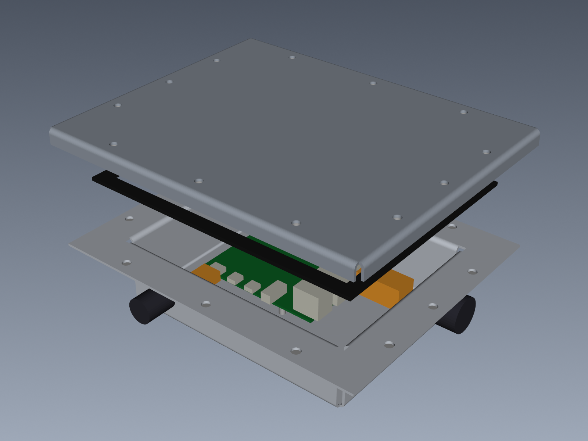

# IP65-target sheet-metal enclosure for a Raspberry Pi 4

A two-part enclosure in 1.5 mm aluminium 5052-H32 for a Raspberry Pi 4 Model B.
- The body is a tray with four walls and an outward flange that forms the gasket land.
- The lid is a flat plate with a short skirt.
- The cables leave through two cable glands, so no Pi port faces the outside.

It is built in build123d as true sheet metal: planar faces with cylindrical bends of inside radius 1.5 mm. The
flat patterns are built from the same parameters, and a separate check unfolds the 3D solid again and compares
it with them.

IP65 is a design target, not a certification. The design has not been made or tested. Every fit and seal statement
below is a CAD check only.

## Design

| Item | Value |
|---|---|
| Material | Al 5052-H32, t = 1.5 mm, inside bend radius 1.5 mm (= t) |
| K-factor | 0.42 (SendCutSend bending calculator, 5052 0.063 in = 1.6 mm; SendCutSend does not list 1.5 mm 5052). Bend allowance 3.346 mm per 90° bend |
| Body | 150 × 110 mm inside, 42 mm tall to the flange top. The flange projects 23.5 mm beyond the wall's outer face (25 mm from its inner face). 8 bends. A 4 × 4 mm relief is cut from each corner of the base, and the bottom bends stop at it. The walls and flanges run to 0.75 mm from the corner, leaving a 2.25 mm gap per axis (3.2 mm across the diagonal, about 40 mm tall) that opens into the relief. Corners, reliefs and flange mitres are TIG welded with filler and ground flush |
| Lid | 205 × 165 mm plate with a 9.25 mm skirt. 4 bends, with the same 4 × 4 mm corner reliefs. Skirt corners and reliefs stay open; they are outside the seal |
| Closed size | 205 × 165 × 45.75 mm, plus the gland bodies outside |
| Seal | EPDM closed-cell sponge strip, 8 × 3 mm. It sits on the flange land 3–11 mm from the wall and is compressed 25 % (3.0 → 2.25 mm). 2.25 mm spacers at each screw stop the lid, so the screws cannot over-compress the gasket. The screws are outside the gasket line. |
| Fasteners | 12 × PEM CLS-M4-1 self-clinching nuts in the flange. 12 × M4 screws through Ø4.5 lid holes |
| Pi mounting | 4 × PEM IFHA-M2.5-12 ingress-protection flush-head studs, on the hole pattern of the official drawing, each with a 6 mm spacer (Ø5 / 2.7) and an M2.5 nut. The stud still passes through a 2.54 mm hole in the base; the seal is the clinched joint itself, which PEM rates IPX7 / IPX9K (ISO 20653) without sealant. A standard FH stud fills the hole too, but PEM states its press fit is not a seal. |
| Cable entries | M16×1.5 gland (cable 4–10 mm) in line with the Ethernet jack. PG7 gland (cable 2–6 mm) in line with the USB-C power plug |

Why no port openings: an opening for a USB or Ethernet jack cannot be IP65 without a sealed panel connector. The Pi
therefore sits inside with its cables plugged in, and they leave through rated glands. "Port clearance" here means the
plugged connectors (RJ45 with boot, USB-C overmold) keep at least 0.5 mm from walls, lid and glands. They keep 6.65 mm
and 2.8 mm.

## Results (verify/report.json)

These are my own checks (`verify/verify.py`, 34 of 34). The reviewer's independent checker is being updated to match.

| Check | Result |
|---|---|
| Body and lid are one valid solid each. The STEP re-imports unchanged and the STL is watertight. | pass |
| Thickness, measured skin to skin by ray casting | 1.4998–1.4999 mm everywhere |
| The STEP is unfolded independently: each section strip area ÷ t gives a length, the K correction is applied, and the result is compared with the DXF flat. | body 276.383 / 236.383 mm, lid 218.192 / 178.192 mm. Equal to the DXF to 0.000 mm |
| Flat area × t, K-corrected, against the STEP volume | 0.00 % difference |
| Every DXF hole folded back to 3D lands on a STEP hole of the same size | 18 + 12 holes, 0.000 mm error |
| Hole edge to bend zone (≥ 2t + r = 4.5 required) | body 6.65 mm, lid 4.75 mm |
| PEM CLS-M4 centre to sheet edge (≥ 6.9 required, PEM data) | 7.5 mm |
| Flange lengths against SendCutSend's 7.7 mm minimum | wall 42, flange 25, skirt 9.25 mm |
| Gasket compression against the 20–30 % IP-rated range | 25 % |
| Bend reliefs, measured on the DXF blanks against SendCutSend's guide (width ≥ t/2, depth ≥ t + r + 0.5 from the bend line) | 4.0 wide, 5.67 deep from the bend line |
| Interference between body, lid, gasket, spacers, nuts, studs, Pi spacers and nuts, glands, Pi envelope and plugs | 0 for every pair |

`verify/break_test.py` breaks the design seven ways, and each break fails the check it should:
- K 0.33 in the flat but 0.42 in the check.
- Nut holes 3 mm from the wall.
- M16 gland 8 mm above the base.
- Gasket squeezed 40 %.
- Pi pushed against a wall.
- Flange cut to 20 mm.
- Relief only 1 mm deep (2.67 mm from the bend line).

## Files

| Path | What |
|---|---|
| `deliver/body.step`, `deliver/lid.step` | one solid each, in the assembly frame |
| `deliver/assembly.step` | body, lid, Pi 4 envelope from the official drawing, plugs, gasket, spacers, PEM parts, glands |
| `deliver/body_flat.dxf`, `deliver/lid_flat.dxf` | blanks in mm: outline as one closed polyline on `OUTLINE`, holes as circles on `HOLES`, one line per bend on `BEND`, bend notes on `NOTES` |
| `deliver/drawing/` | fabrication drawings, A3 1:2: body flat, lid flat (bend table with order, hole table), assembly with BOM |
| `deliver/render/` | renders |
| `report.json`, `spec.json` | measured values, and the dimensions this design commits to |
| `sm/params.py` | every number, with its source |

Run everything with `python run_all.py` (Python 3.11 with build123d 0.13, trimesh, vtk, ezdxf; PyMuPDF for the PDFs).

## Process order

One sequence for the body; the PEM hardware goes in last:

1. Bend the four flanges (DOWN 90°), then the four walls (UP 90°).
2. Weld the corners, reliefs and mitres closed (see below).
3. Leak test the welded corners.
4. Flatten the gasket land to 0.3 mm.
5. Press the CLS-M4-1 nuts and the IFHA-M2.5-12 studs. The IFHA head sits flush on the outside of the base, with the
   stud pointing into the box. Install from the punch side and do not deburr the hole (PEM IPF bulletin, p. IPF-5).

The lid's four skirts are DOWN 90°. The step column in the bend tables gives the sequence. On the wall bends the
finished 23.5 mm flanges hang off the tool, so confirm with the fabricator that their box-and-pan brake clears them.

## Welding and the gasket land

The flange mitres run about 23 mm across the gasket land, and TIG welding 1.5 mm aluminium will pull the land out of
flat. Require a gasket-land flatness of 0.3 mm after welding, using a fixture or a light skim. The tolerance matters
because the 2.25 mm spacers fix the lid height. A land that is 0.5 mm low in places drops the local compression from
25 % to about 8 %, which is too little to seal.

After bending, each corner leaves an L-shaped opening of about 7 × 7 mm: the 4 × 4 mm relief plus the bend zones,
and the 2.25 mm gap between the walls above it. That is too wide to close with filler alone without heavy heat
input. Close it with a welded patch, or with a tab folded across the corner, and then leak test every corner
(for example a soapy-water or dye-penetrant check on the inside) before the land is flattened. The flat drawings
dimension one corner notch; all four are alike.

## Sources

- **Raspberry Pi 4 B:** the official mechanical drawing, https://datasheets.raspberrypi.com/rpi4/raspberry-pi-4-mechanical-drawing.pdf,
  downloaded 2026-11-18.
  - Hole pattern, connector centres and component heights are taken from its dimensions.
  - Each connector's box size is read from the drawn outline, because the drawing does not dimension it.
- **K-factor and minimum flange:** SendCutSend bending calculator. 5052 minimum bend radius 1 × t: SendCutSend 5052 page.
- **PEM CLS-M4-1:** hole 5.41, minimum sheet 1.0, centre to edge 6.9 (pemnet.com).
- **PEM IFHA-M2.5-12:** hole 2.50 +0.08, minimum sheet 1, centre to edge 5.4, lengths 10–18, sheet hardness HB 82
  or less (PEM IPF bulletin, p. IPF-3; 5052-H32 is about HB 60). Rated IPX7 / IPX9K to ISO 20653, tested in CR4,
  6082-T6 and 304 (p. IPF-2). Install from the punch side, no deburring (p. IPF-5).
- **Bend reliefs:** SendCutSend relief guide: width ≥ thickness / 2, depth ≥ thickness + bend radius + 0.5 mm from the bend line.
- **Glands:** Lapp SKINTOP data sheets and thread table. M16 entry hole 16.0–16.2, PG7 12.5–12.8.
- **Gasket compression:** Stockwell Elastomerics, 20–30 % for IP-rated seals.

The full URLs are in `sm/params.py` → `SOURCES`.

## Not certain

1. Bend data. SendCutSend's K 0.42 is for 1.6 mm (0.063 in) 5052 on their own tooling, with an effective inside
   radius of 0.89 mm; they do not stock 1.5 mm. The radius matters more than K here:
   - An air bend in 5052-H32 1.5 mm over a 12 mm V-die gives an inside radius of about 1.9 mm (≈ 0.16 × V, a shop
     rule of thumb, not a standard). That changes each bend by about +0.6 mm. The 4 mm reliefs already cover that
     radius (t + r + 0.5 = 3.9).
   - K anywhere from 0.38 to 0.45 moves it by only −0.09 / +0.07 mm.

   Get the fabricator's inside radius and K, or their bend deduction, and re-run before cutting.
2. Plug lengths. The USB-C plug with strain relief (30 mm) has no source. The RJ45 plug is a 22.5 mm booted plug
   (Delock) plus a margin. Measure the cables you will use.
3. PEM studs and nuts.
   - The nut barrels and studs in the assembly are envelopes, not data-sheet bodies. The M4 screw length must be
     checked against the CLS-M4-1 thread length.
   - PEM tested the IFH seal in CR4, 6082-T6 and 304, not in 5052. A 5052 test coupon is needed before relying on it.
   - PEM warns against bending after installation. Here the studs go in after all bends, which is the order they ask for.
   - PEM's tooling changes at 1.51 mm sheet. 1.5 mm sheet with a plus tolerance can fall either side, so measure the
     sheet and tell the installer.
   - If the coupon leaks, a sealant under the head is the fallback.
   - The IFHA hole band is 2.50–2.58. The DXF cuts it at 2.54, the middle of the band, which leaves ±0.04. Confirm
     that the cutter holds ±0.04 on these four holes; if not, cut them undersize and ream to 2.52–2.54. Check them with 2.50 go and 2.58
     no-go pins.
4. Hardware sizes. The PG7 hole (12.7 mm) is in the middle of the 12.5–12.8 range quoted by different makers; use
   the value of the gland you buy. The gland locknut size was not found and is modelled from the body wrench size.
5. Corner seal. The seal at the corners depends on the welds. The corner openings and the flange mitres must be
   closed (patch or folded tab), leak tested, and the land kept flat to 0.3 mm (see above).
